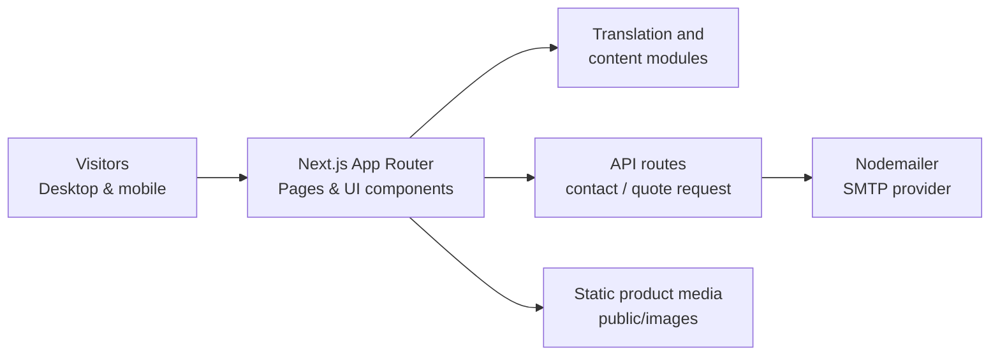

# Afrigate — Multilingual B2B Corporate Website

**Next.js 16 · React 19 · TypeScript · Tailwind CSS 4 · Nodemailer**

An import/export business website project built with the **Next.js App Router**. The codebase focuses on a responsive corporate experience, multilingual content, a navigable product-category catalog and server-side contact/quotation request endpoints.

> **Portfolio scope:** this repository contains implementation code and static media assets. A public production deployment and end-to-end email delivery were **not independently verified** for this documentation update. The client-facing deployment may require separate permission to share.

## Product capabilities

- Responsive home, company, services, products, contact and quotation-request pages.
- Product-category detail routes using dynamic Next.js slugs.
- A language selector for **French, English and Arabic**.
- Server-side endpoints for contact and quotation submissions.
- SMTP email integration via Nodemailer, requiring valid runtime configuration.
- Reusable navigation, content, forms and shared UI components.

## System architecture



This diagram is a simplified view of the repository structure; it is not evidence of a live deployment.

## Repository structure

```text
src/
  app/
    page.tsx                # Home page
    a-propos/               # About
    services/               # Services
    produits/               # Product catalog
    produits/[slug]/        # Product category pages
    contact/                # Contact
    demande-devis/          # Quotation request
    api/                    # Server endpoints
  components/               # Reusable UI components
  data/                     # Business content, categories, navigation
  i18n/                     # Language provider and translations
  lib/                      # Shared application helpers
public/
  images/                   # Product and corporate media
  videos/                   # Hero media
```

## Run locally

Requires Node.js compatible with **Next.js 16**, npm and an environment able to run the App Router.

```bash
git clone https://github.com/Edam-laa/afrigate-site.git
cd afrigate-site
npm ci
npm run dev
```

Open `http://localhost:3000`.

Quality checks:

```bash
npm run lint
npm run build
```

These commands are documented for reproduction; successful execution has **not** been independently claimed in this README revision.

## Email configuration

The API routes use Nodemailer with configuration supplied at runtime. Start from [`.env.example`](.env.example) and create an untracked `.env.local`. The implementation expects SMTP configuration and destination addresses, for example:

```env
SMTP_HOST=
SMTP_PORT=
SMTP_SECURE=
SMTP_USER=
SMTP_PASS=
SMTP_FROM=
ADMIN_EMAIL=
QUOTE_RECEIVER_EMAIL=
CONTACT_RECEIVER_EMAIL=
```

Never commit real credentials. Test form validation and end-to-end email delivery in an authorized environment before enabling a public deployment. A successful build does not guarantee delivery.

## UI evidence

This repository includes authentic **site media assets** but no independently verified screenshot of the rendered desktop/mobile interface. Do not mistake static photographs for proof that a live website is deployed.

Once an authorized deployment is available, add a real sanitized screenshot or an approved demo URL here; never fabricate a running application screenshot.

## Engineering decisions

- **Next.js App Router:** organizes public pages, nested product-category routes and server endpoints in one application.
- **TypeScript:** explicit types for maintainable business content and reusable components.
- **Dedicated i18n layer:** centralizes language switching and translations.
- **Server-side email handling:** protects the SMTP secret from the client bundle; requires deployment-side environment variables and proper operational safeguards.

## Known limitations and next steps

- Confirm a public deployment URL and screenshot-sharing rights.
- Independently verify desktop/mobile responsiveness and the French/English/Arabic user journeys.
- Execute lint/build checks on the committed state.
- Test form error handling, SMTP delivery and spam prevention in a controlled environment.
- Audit and optimize large media files, especially hero video assets.

**Context:** Business website development project. Company names, logos and images remain subject to their respective owners' rights.
