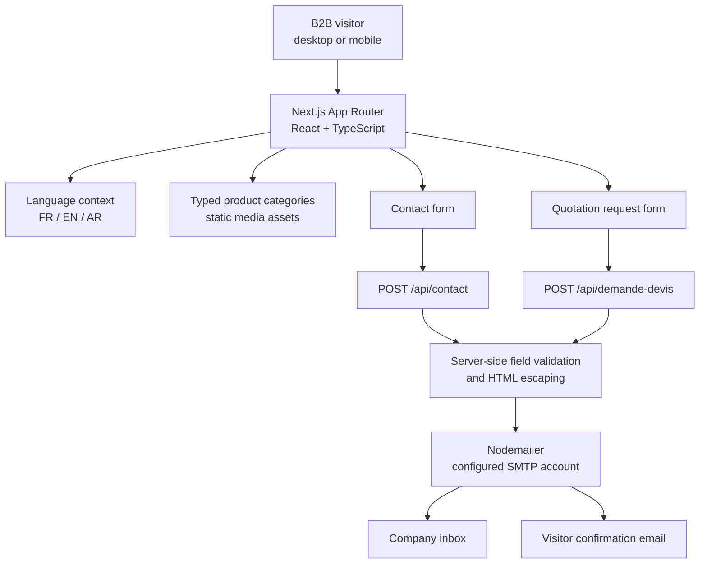

# Afrigate — Multilingual B2B Website & Quotation Experience

**Next.js 16 · React 19 · TypeScript · Tailwind CSS 4 · App Router · Nodemailer**

A business-facing web application for an international sourcing and import/export company. The project combines a **responsive corporate website**, a multilingual product-category catalog, dynamic product routes and **server-handled contact and quotation forms**.

**Engineering focus:** component-driven frontend development, localized content, typed catalog data, server endpoints, business-form integration and deployment considerations.

> **Portfolio status:** source code and original media assets are available. This repository does **not** currently provide a verified live demo, authentic rendered-UI screenshots or independently confirmed end-to-end email delivery. Business branding and media remain subject to their owners' rights.

## Business problem

For a B2B sourcing company, a website is more than a brochure. Visitors need to understand the services, discover relevant product families, and communicate concrete procurement requirements.

The application is organized around that journey:

1. **Discover** the company's services and sectors.
2. **Explore** structured product categories and category-detail pages.
3. **Switch language** between French, English and Arabic.
4. **Contact the company** or submit a quotation request with product and logistics details.
5. **Process the request server-side** through configured SMTP delivery and confirmation logic.

## What is implemented?

| Feature | Code evidence | Implementation notes |
| --- | --- | --- |
| Responsive corporate homepage | [Home route](src/app/page.tsx) and [hero component](src/components/home/Hero.tsx) | Reusable sections, prominent calls to action and video/fallback hero media |
| Multi-page information architecture | [App Router pages](src/app/) | About, services, product catalog, contact and quote-request screens |
| Dynamic product-category pages | [Dynamic slug route](src/app/produits/%5Bslug%5D/page.tsx) | Category information and metadata derived from typed source data |
| French / English / Arabic content | [Translation catalog](src/i18n/translations.ts) and [language provider](src/i18n/LanguageProvider.tsx) | User-selected language is stored locally; Arabic text is translated but the global layout intentionally remains LTR |
| Structured product data | [Product categories](src/data/productCategories.ts) | Typed categories, descriptions, images and localized product information; this is **static source data**, not a database-backed inventory |
| Contact form processing | [Contact endpoint](src/app/api/contact/route.ts) | Server-side SMTP message and visitor confirmation via Nodemailer |
| B2B quotation requests | [Quotation endpoint](src/app/api/demande-devis/route.ts) and [form UI](src/components/quote/QuoteRequestContent.tsx) | Captures client, product, quantity, destination, budget and requested deadline |
| Shared design system | [UI components](src/components/ui/) and [site layout](src/components/layout/) | Consistent navigation, calls to action and reusable sections |

## Architecture — client experience to email delivery



This is a **source-code architecture**, not an independently verified production deployment. The routes send mail using SMTP; **there is no CRM, persistent database, payment system or inventory synchronization** in this repository.

## Interface design and original assets

The source uses a dark navy-and-gold corporate visual language, large typography, a responsive navigation layout, category imagery and a full-width video hero.


*Repository-provided hero photography. This is an authentic project asset but **not** a screenshot of a running interface.*

| UI element | Source |
| --- | --- |
| Animated hero and fallback image | [Hero component](src/components/home/Hero.tsx) |
| Product and service previews | [Home components](src/components/home/) |
| Navigation and multilingual control | [Header](src/components/layout/Header.tsx) · [Language switcher](src/components/layout/LanguageSwitcher.tsx) |
| Product detail experience | [Product category component](src/components/products/ProductCategoryContent.tsx) |
| Quote-request experience | [Quotation form](src/components/quote/QuoteRequestContent.tsx) |

**Portfolio evidence still needed:** a rights-approved, *real* desktop and mobile screenshot from a running build. Static photographs and mock visuals should never be labeled as application screenshots.

## Important technical decisions

### 1. Next.js App Router for pages and API endpoints

The same codebase provides route-based UI screens and server-side request handlers. Dynamic product-category pages use `[slug]` routes and category metadata from a typed data module.

### 2. Content-driven product categories

Product categories and translated descriptions are kept in [TypeScript data structures](src/data/productCategories.ts), supporting consistent presentation without introducing an unnecessary backend database for this website version.

### 3. Centralized localization

The [language provider](src/i18n/LanguageProvider.tsx) maintains a French default, falls back to French for missing keys, and saves the visitor's preference in browser local storage. English and Arabic content exist, but translation completeness and right-to-left accessibility still require dedicated review.

### 4. Server-side forms instead of shipping SMTP secrets

The two API routes accept form fields and build email content on the server. Contact and quotation requests can send a company-facing message followed by a customer-facing confirmation. SMTP secrets belong in runtime configuration, not client-side JavaScript.

**This is email-based inquiry delivery, not persistent request management.** In the quote flow, a failed confirmation email is handled separately after the company-facing message; delivery behavior and failure reporting still need integration tests.

## Repository structure

```text
src/
  app/
    page.tsx                    Homepage
    a-propos/                   About the business
    services/                   Services
    produits/                   Product category catalog
    produits/[slug]/            Dynamic category detail pages
    contact/                    Contact form
    demande-devis/              Quotation request
    api/contact/                Contact email handler
    api/demande-devis/          Quotation email handler
  components/
    home/                       Reusable homepage sections
    layout/                     Header, footer, language switcher
    products/                   Product-category UI
    quote/                      Quotation-request UI
    ui/                         Reusable UI primitives
  data/                         Typed business and product content
  i18n/                         Translation catalogs and language state
public/
  images/                       Company/product photos and logos
  videos/                       Homepage hero media
```

## Run locally

**Requirements:** a Node.js version compatible with Next.js 16, npm and a development environment able to execute React/Next.js.

```bash
git clone https://github.com/Edam-laa/afrigate-site.git
cd afrigate-site
npm ci
npm run dev
```

Open **http://localhost:3000**. The pages can be reviewed without a configured SMTP provider, but **sending contact or quotation emails requires additional setup**.

Project checks:

```bash
npm run lint
npm run build
```

These are supported scripts in [`package.json`](package.json); a fresh passing run is **not claimed** by this README.

### SMTP configuration

Copy [`.env.example`](.env.example) into a locally ignored `.env.local` and supply your **own authorized** SMTP host/account and destinations.

```dotenv
SMTP_HOST=
SMTP_PORT=
SMTP_SECURE=
SMTP_USER=
SMTP_PASS=
QUOTE_RECEIVER_EMAIL=
QUOTE_SENDER_EMAIL=
CONTACT_RECEIVER_EMAIL=
CONTACT_SENDER_EMAIL=
```

These are the actual repository template keys. The quotation endpoint requires both `QUOTE_RECEIVER_EMAIL` and `QUOTE_SENDER_EMAIL`. The contact endpoint can fall back to the quotation addresses or SMTP user when its optional sender/receiver settings are not specified.

**Never commit credentials or copy a real company's mail settings into a public demo.** A successful development build does not prove that an SMTP provider accepted or delivered the emails.

## Known limitations and engineering follow-ups

1. **SMTP certificate verification:** both API handlers currently set Nodemailer's `tls.rejectUnauthorized` to `false`. This weakens TLS security and **must be fixed and validated before real production email use**.
2. **Abuse protection:** public forms require stronger anti-spam measures such as server-side rate limiting, bot protection and request-size constraints.
3. **Validation:** the quote endpoint checks required fields and email syntax; contact validation is less strict. A shared schema and explicit input-length constraints would improve consistency.
4. **No persistent business backend:** enquiries are delivered by email, not stored in a database/CRM or exposed through a tracking dashboard.
5. **Localization accessibility:** French/English/Arabic content is present, but full Arabic RTL behavior and systematic language QA are not implemented.
6. **Media performance:** the committed homepage hero MP4 is approximately **97 MB**. Encoding, streaming strategy and web-performance testing should be reviewed.
7. **Proof of delivery:** add authenticated release screenshots, a permitted demo URL, and logged quality/accessibility tests before claiming production readiness.
8. **Automated testing:** the repository has lint/build scripts but does not currently include a verified automated UI/API test suite.

## What this project demonstrates

**Frontend product development · Next.js routing · TypeScript data modeling · reusable components · internationalization · server-side form handling · media-rich responsive UI · pragmatic delivery constraints**

The strongest portfolio story here is the translation of business needs into a consistent website and inquiry experience — with clear boundaries between implemented functionality, unverified operations and the work needed for production hardening.
